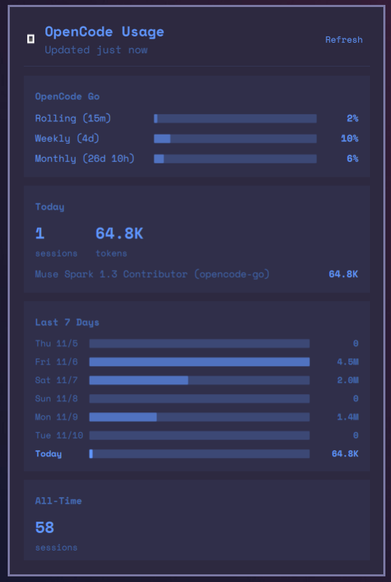

# dizziee.opencode-model-usage

OpenCode token usage stats in the Omarchy bar. Displays today, weekly, and all-time token counts per model, plus the OpenCode plan's rolling, weekly, and monthly meters with live countdowns.

## Requirements

- Python 3
- OpenCode (official) https://github.com/anomalyco/opencode
  - Arch: `pacman -S opencode`
- OpenCode with existing session data in `~/.local/share/opencode/opencode.db`

## Installation

```sh
omarchy plugin add https://github.com/JJDizz1L/dizziee.opencode-model-usage.git --enable
```

### Then place it in your bar layout with

`omarchy bar put dizziee.opencode-model-usage [--section <left|center|right>]`

Suggested placement:

```
omarchy bar put dizziee.opencode-model-usage --section left
```

You can validate the plugin at any time with:

```sh
omarchy plugin validate ~/.config/omarchy/plugins/dizziee.opencode-model-usage
```

## Updating

To pull the latest version of the plugin:

```sh
omarchy plugin update dizziee.opencode-model-usage --yes
```

## Configuration

Configuration lives in `~/.config/omarchy/shell.json`. The supported way to change it is:

```sh
omarchy bar set dizziee.opencode-model-usage refreshIntervalSec 900 --json
```

| Key | Type | Default | Description |
|---|---|---|---|
| `refreshIntervalSec` | integer (30–3600) | 900 | How often the background scan may run (seconds) |

Numbers need `--json`, or they land in `shell.json` as strings. The panel's settings view (right-click the bar icon) writes the same value.

A background tick only starts Python when the cached snapshot is older than 90% of the interval. Opening the panel refreshes only if the snapshot is more than 30 seconds old; `r`, the Refresh button, or middle-clicking the bar icon forces a scan. The online meters run a separate, faster lane (see below), so opening the panel also refreshes them if they are more than 60 seconds old.

## Online plan meters (zero setup)

Each scan also asks the packaged `omarchy.agents` collector (`omarchy-agent-usage-opencode --limits-only`) for its secret-free record and merges only the display fields: `limits` (rolling / weekly / monthly percent + reset time), `tierLabel` (e.g. `Go`), `limitsStale`, and the status/help texts. Credential discovery stays inside that collector (env keys → opencode's credential store → `auth.json` files → Console session), so this plugin never reads, logs, or caches any API key or token — the panel shows the same meters as the agents panel with nothing to configure. A machine with no Go plan, or no collector installed, simply shows local stats; pass `--no-limits` to the scanner for local-only output.

Each meter row pairs its bar with the live countdown folded into the label — `Rolling (40m)`, `Rolling (4h)`, `Rolling (3h 23m)`, `Weekly (4d 5h)`, `Monthly (27d)`, `Monthly (24d 10h)` — using the same bar treatment as the Last 7 Days card. A window at 90% or more turns urgent, and the card title follows the hottest window.

The meters are cheap (the collector owns its own per-credential cache), so they refresh on a faster lane than the sqlite scan: every `min(180, refreshIntervalSec)` seconds the scanner runs with `--limits-only`, which reuses the cached local stats and only renews the meters — mirroring the packaged agents panel's limits-only cadence. `scannedAt` is left untouched so the full-scan schedule is unaffected, and a failed fetch keeps the last good meters.

## Data and cache

The scanner opens OpenCode's SQLite database read-only and extracts only the model and token fields it needs for aggregate counts. It never copies the database, and message text is never stored or shown. The time window is index-backed and the grouping projection is materialised in memory, so a scan does not spill a temporary file to disk.

The last successful result is cached at `~/.cache/omarchy/dizziee.opencode-model-usage.json`. That file is the compact aggregate the panel draws — currently about 4 KB, hard-capped at 128 KB — never messages or a database copy. The cache lets the bar paint immediately at shell start without spawning Python, and every bar instance watches it so one scan reaches every monitor. A failed scan leaves the cache and the displayed numbers alone and starts retrying after 30 seconds, backing off to five minutes; the panel marks the numbers stale and shows the last good result.

The plugin itself makes no network requests: per-model stats come from the local database, and the online meters arrive via the packaged collector's cached record (the only component that talks to OpenCode's usage endpoint).

## Translations

Every UI string comes from `i18n/en.json` through `Commons.Translations`, so the panel, bar tooltip, settings view, and error states follow the language picked under **Setup → Language** without a shell restart. Counts use `Commons.I18n.formatNumber` and weekday names use the language's locale.

To add a language, copy `i18n/en.json` to `i18n/<code>.json` (for example `da.json`, `pt-BR.json`) and translate the values. Keep the keys and the `%1`/`%2` placeholders unchanged. A missing key falls back to the base language (`pt-BR` to `pt`), then to English, then to the key itself, so a partial catalog is safe. Strings that count use CLDR plural forms:

```json
"opencode.moreModels": {
  "one": "+%1 more model",
  "other": "+%1 more models"
}
```

Raw scanner diagnostics stay in English as technical detail; the surrounding status text is translated.

## IPC

```sh
omarchy-shell dizziee.opencode-model-usage open
omarchy-shell dizziee.opencode-model-usage close
omarchy-shell dizziee.opencode-model-usage toggle
omarchy-shell dizziee.opencode-model-usage refresh
omarchy-shell dizziee.opencode-model-usage settings
```

## Preview



## Uninstall

```sh
omarchy plugin remove dizziee.opencode-model-usage
rm -f ~/.cache/omarchy/dizziee.opencode-model-usage.json
```

## License

MIT
